<a href="https://github.com/MattyIceMatrix">
  <picture>
    <source media="(prefers-color-scheme: dark)" srcset="dark_mode.svg">
    
  </picture>
</a>

## `$ whoami`

Edge AI and AI-governance engineer in Kaiserslautern, Germany. Eight years U.S. Army, now enterprise IT by day and AI systems the rest of the time.

I build in one direction: **AI you can hold accountable.** As agents start touching real infrastructure, the hard problem stops being capability and becomes evidence — can you prove what a system was allowed to do, what it actually did, and that a human stayed in the loop? Everything below is some part of that answer, or the edge hardware it has to run on when the network is gone.

**Start here →** [VLC-1](https://github.com/MattyIceMatrix/vlc-1) (the open specification) · [LANTERN](https://github.com/MattyIceMatrix/lantern) (the edge build) · [Project Atlas](https://github.com/MattyIceMatrix/project-atlas) (what's next)

---

## `$ ls ~/projects`

24 repositories: 7 public, 17 private. Private projects are listed by what they do; their code, methods and results are shared only on request, under NDA where needed.

### ⚡ Edge AI

| Project | What it does | Stack |
|---|---|---|
| **[LANTERN](https://github.com/MattyIceMatrix/lantern)**  | Offline edge-AI kit for flood search and rescue: perception, mission agents and a local LLM that keep working when the mobile network is gone. Phase 0 prototype, built in the open against the 2021 Ahr valley flood as the reference scenario. | `Python` `Jetson` `ROS 2` |
| **[tinyquant](https://github.com/MattyIceMatrix/tinyquant)**  | INT8 quantization and a C inference engine for running small models on constrained hardware. | `C` `Python` |
| **KRYPTON · Proving Ground**  | Safety and validation tooling for machine-learning models that run on industrial machine controllers. Research prototype on simulated data. | `Python` `ONNX` `Edge inference` |
| **Bounce AI**  | On-device basketball shooting coach (*Biomechanical Observation Unit for Neural Coaching at the Edge*). | `Python` `C` `TFLite` |

### 🔒 AI governance and formal verification

| Project | What it does | Stack |
|---|---|---|
| **[VLC-1](https://github.com/MattyIceMatrix/vlc-1)**   | Open specification and conformance checker for proving an AI audit log is complete, not just tamper-evident. Free to use, free to score against — [moore-labs.com](https://moore-labs.com). | `Python` `Coq` |
| **OCTA Observer**  | Formally verified runtime enforcement for AI systems on Linux. Part of OCTA — *Observe, Connect, Transform, Adapt*. | `Coq` `C` `Rust` |

### 🏭 Compliance software

| Project | What it does | Stack |
|---|---|---|
| **Moore Labs**  | Offline, bilingual (German/English) compliance and security tools for European companies: EU AI Act, Cyber Resilience Act, NIS2, DORA, GDPR and e-invoicing. | `Python` |
| **ATLAS HR**  | Enterprise HR platform — recruitment, retention, compensation, performance and workforce planning, with a policy assistant and an EU AI Act governance console. Live on edge-serverless infrastructure; demonstration data is synthetic. | `Workers` `D1` `Workers AI` |

### 🗺 Engineering plans

| Project | What it does | Stack |
|---|---|---|
| **[Project Atlas](https://github.com/MattyIceMatrix/project-atlas)**  | Public catalogue of 50 build-ready project briefs across edge AI, generative AI, AI safety, cyber defence, MLOps and geospatial. Each one sized, phased and gated, so the scope is fixed before any code is written. | `Markdown` `YAML` |

### 🌐 Live web apps

| App | What it is |
|---|---|
| **[MineDime Terminal](https://mattyicematrix.github.io/minedime/)** | Commodity intelligence terminal with a quant research lab. Simulated data. |
| **[Wochenkorb](https://mattyicematrix.github.io/wochenkorb/)** | Weekly ALDI SÜD and LIDL deals, a budgeted shopping list and recipes built from the deals. |

### 🛠 Tooling I build for myself

| Project | What it is |
|---|---|
| **EMBERWATCH**  | A never-ending local training range: DevOps, AI/ML and architecture missions run from VS Code, with XP, ranks and a C++ mastery track aimed at edge work. |

### 🎓 Coursework projects (Udacity · MS in AI track)

31 graded projects passed, each reviewed against a rubric. Nine nanodegree certificates earned: Agentic AI · Agentic AI Engineer with LangChain and LangGraph · AI Programming with Python · Artificial Intelligence · Data Analyst · Deep Learning · Generative AI · Introduction to Machine Learning with PyTorch · Introduction to Machine Learning with TensorFlow. Plus courses in Model Context Protocol, Building Convolutional Neural Networks for Computer Vision, Embedded Systems and Robotics Fluency, and AI Governance, Policy and the Public Good.

| Area | Projects |
|---|---|
| **Agentic AI and LLM systems** | AI Red-Teaming · AgentsVille Trip Planner (multi-agent travel assistant) · AI-Powered Agentic Workflow for Project Management · Beaver's Choice Paper Company (multi-agent inventory, quoting and sales) · Report-Building Agent · Autonomous Knowledge Agent · PriceScout (agentic analyst, Model Context Protocol) · EcoHome Energy Advisor (LangGraph) · Market Research Agent · NASA Mission Intelligence (RAG-based chat system) · OmniTrainer (multimodal customer service trainer) · Teaching an LLM to Count |
| **Machine learning, deep learning and classical AI** | Build an Adversarial Game Playing Agent · Build a Forward-Planning Agent · Build a Sudoku Solver · Part of Speech Tagging · Machine Translation · Build a Transformer-Based Q&A System · Landmark Classification & Tagging for Social Media · Synthetic Handwriting Generator for CAPTCHA Systems · Diabetes Risk Prediction with PyTorch · Model Salary Data with Linear Regression · Create Your Own Image Classifier, PyTorch (CIFAR-10 CNN, 88.6% test accuracy) · Create Your Own Image Classifier, TensorFlow · Transformers for Movie Review Sentiment Analysis (76.8% test accuracy) · Finding Donors for CharityML · Creating Customer Segments with Arvato · A Data-Driven Approach to AI and Python |
| **Data analysis** | Investigate a Dataset · Real World Data Wrangling with Python · Communicate Data Findings |

### 🗂 Earlier prototypes (2026)
Single-file web apps from the first phase of Moore Labs, all private: **OCTA Systems** (AI-governance dashboard), **SnapWave** (Wi-Fi planning and IoT fleet management), **Earth: Solved** (planetary scenario modelling), **ShellForge** (IT training) and **Precision Procurement Academy** (procurement training).

### 🤝 Open-source contributions
Gateway audit-log reports to Maxim AI (Bifrost, **fixed upstream**), IBM, NVIDIA, Docker, the Linux Foundation's agentgateway and Lasso Security; a comment on the LF Decentralized Trust Proof-of-Control draft; and the outside reviewers who have improved VLC-1. **[Full list →](CONTRIBUTIONS.md)**

### 📐 Standards and working groups
Tracking and contributing where agent audit evidence is being specified: IETF audit-architecture drafts, LF Decentralized Trust Proof-of-Control, and the AAIF governance, risk and regulatory working group. VLC-1 exists because a standard nobody can check isn't a standard.

---

## `$ cat ~/.contact`

Open to edge AI and generative AI engineering work, remote, based in Germany long-term. Active Secret clearance.

📫 **hello@moore-labs.com** · 🌐 **[moore-labs.com](https://moore-labs.com)** · 💼 **[LinkedIn](https://www.linkedin.com/in/matthew-moore-35b982212/)**

*If you're building AI that has to answer for itself, open an issue on VLC-1 or send a log — I'll score it.*
